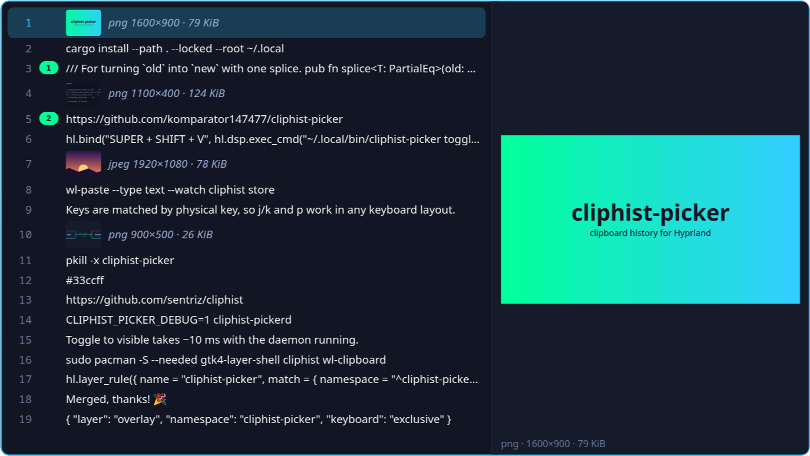

# cliphist-picker

A fast clipboard history picker for Hyprland on top of
[cliphist](https://github.com/sentriz/cliphist). It is a GTK4 layer-shell
overlay: always above other windows (including special workspaces), keyboard
driven, with image thumbnails and multi-select paste.



- `cliphist-pickerd` stays running with a hidden, pre-warmed window and
  listens on `$XDG_RUNTIME_DIR/cliphist-picker.sock`.
- `cliphist-picker [toggle|show|hide]` is a tiny client without GTK
  (~1 ms). If the daemon isn't running, it starts it and shows the picker.

Toggle to visible takes ~10 ms with the daemon running.

## Keys

Keys are matched by physical key (hardware keycode), so they work the same in
any keyboard layout.

| Key | Normal mode | Search mode |
| --- | --- | --- |
| `j` / `k`, ↓ / ↑, PgDn / PgUp | move | ↓ / ↑ move, letters go to the search field |
| `g` / `G`, Home / End | first / last | |
| Space | mark / unmark, move down | same |
| Enter (or double click) | copy the entry under the cursor | same |
| `p` | paste marked entries in the order they were marked (or the current one) | |
| `/` | search (fuzzy, best matches first) | |
| Esc, `q` | close | Esc: back to normal mode, the filter stays |

Numbers are positions in the history (1 = newest), also while filtering.

Pasting hides the picker, then pipes the selected `cliphist list` lines to
`~/.local/bin/hypr-clipboard-paste` (from [my dotfiles](https://github.com/komparator147477/dotfiles/blob/main/bin/.local/bin/hypr-clipboard-paste)). It joins consecutive
text entries with newlines into one paste and pastes images one by one, without
reordering the history.

## Install

Needs GTK 4 and `gtk4-layer-shell`, plus `cliphist` and `wl-clipboard` at
runtime.

```sh
cargo install --path . --locked --root ~/.local
```

Hyprland config:

```lua
hl.on("hyprland.start", function()
  hl.exec_cmd("~/.local/bin/cliphist-pickerd")
end)
hl.bind("SUPER + SHIFT + V", hl.dsp.exec_cmd("~/.local/bin/cliphist-picker toggle"))
-- The default layersIn fade adds a visible delay.
hl.layer_rule({ name = "cliphist-picker", match = { namespace = "^cliphist-picker$" }, no_anim = true })
```

After `cargo install`, restart the daemon: `pkill -x cliphist-picker` (the
process name is truncated to 15 characters), then press the shortcut.

## Style overrides

`$XDG_CONFIG_HOME/cliphist-picker/style.css` (usually
`~/.config/cliphist-picker/style.css`) is loaded after the built-in theme and
read when the daemon starts. For example, a translucent background:

```css
.frame { background-color: rgba(18, 22, 36, 0.70); }
.preview { background-color: rgba(22, 27, 43, 0.45); }
entry.search { background-color: rgba(26, 31, 48, 0.70); }
```

Let Hyprland blur what's behind it by adding `blur = true, ignore_alpha = 0.3`
to the layer rule above.

## Debugging

The daemon started by the client logs to `$XDG_RUNTIME_DIR/cliphist-picker.log`.
With `CLIPHIST_PICKER_DEBUG=1` it prints how long each show takes.

```sh
cargo test
```
